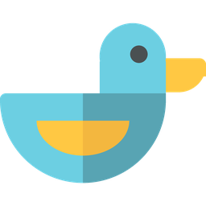

<p align="center"></p>

<h1 align="center">Duck</h1>

<p align="center"><b>A GPU terminal with a built-in multiplexer, made for working with AI agents.</b><br>
Rust · wgpu · Lua config · Windows first, Linux and macOS builds</p>

<p align="center"><a href="README.pt-BR.md">Leia em português</a></p>

---

Duck is a terminal emulator and multiplexer in one program. Closing the window
detaches instead of killing your shells, and the terminal knows which panes run
an AI agent (Claude Code, Codex, Kiro, Gemini, aider…) and what each one is
doing.

## Why Duck

- **Sessions that survive.** Every shell lives in its own `ptyhost` process.
  Closing the window, or even a crash of the server, keeps everything running;
  the next server reconnects. A checkpoint every 5 minutes restores workspaces,
  tabs and splits after a reboot, and **resumes the Claude Code conversations**
  that were open (`claude --resume`).
- **Agent aware.** Each tab shows whether its agent is working, waiting for
  your approval or done. Approve or deny from the notice in the corner of the
  screen without switching tabs. Side panel with the agent's plan,
  context tokens and cost; timeline of the session; message queue delivered
  when the agent stops; "fix with agent" sends a failed command and its output.
- **Orchestrates agents.** Loop until a check passes (Duck runs your tests
  when the agent stops and sends the failure back until it passes); a map of
  agents, the panes they opened and their subagents; an inbox of what is
  waiting for you; an agent in a fresh worktree with its own port; Routines
  that send requests to Claude Code on a schedule.
- **Agents talk across computers.** `duck msg fedora "run X and tell me Y"`
  sends a message from the agent on one computer to the agent on another, with
  no copy and paste between them. You approve it before it reaches the agent;
  the reply comes back to the pane that asked. Direct between the two Duck
  servers (over Tailscale or the local network), no outside server.
- **Tabs you don't lose.** Pinned tabs, reopen the last closed one
  (`Ctrl+Alt+T`, with the agent session), jump back to the previous one
  (`Alt+Q`), picture-in-picture of a pane over other tabs, and a preview with
  your last request to the agent and the files it touched.
- **Secrets protected.** A token that shows up on screen is masked (and kept
  out of recordings and of what agents read); `duck guard install` blocks
  secrets and client names in commits and pushes.
- **Easy to find.** Topic menus (`Ctrl+Shift+1..4`: orchestration,
  extensions, window, settings) and a bar with the main shortcuts; all
  customizable.
- **Command blocks.** With shell integration (OSC 133), every command becomes a
  card with exit code and duration, copy/re-run/collapse/pin buttons, and a
  minimap that marks failures.
- **Its own look.** Custom title bar, tabs as pills (or vertical tabs), panes as
  rounded cards, smooth cursor, command palette that also searches tabs,
  sessions, history and files, 22 built-in themes plus a theme generated from
  your wallpaper, Mica/Acrylic on Windows 11, post-processing shaders.
- **Scriptable.** Config in Lua with hot reload, key tables, workflows,
  layouts, WASM plugins, a CLI and an MCP server so agents can drive the
  terminal (`duck cli spawn`, `read`, `send`, `blocks`, `last-failure`…).
- **Light.** One native binary (~19 MB), idle CPU ~0%, about 12k lines/s of
  output throughput.

## Install

### Ready-made (no Rust needed)

Downloads the latest [release](https://github.com/herlondf/duck/releases) for
Linux x86_64 or Windows x64, checks it and runs the installer. Running it again
updates Duck.

```sh
curl -fsSL https://raw.githubusercontent.com/herlondf/duck/main/get.sh | sh
```

```powershell
irm https://raw.githubusercontent.com/herlondf/duck/main/get.ps1 | iex   # installs to %LOCALAPPDATA%\Duck; needs PowerShell 7
```

Installer options go after `sh -s --` (Linux) or through
`& ([scriptblock]::Create((irm .../get.ps1))) -Boot` (Windows).

**Updates:** Duck checks for a new release once a day and tells you. Then
**Ctrl+Shift+P > Atualizar o Duck** (or `duck update`) downloads, checks and
installs it and restarts the server; the shells keep running. Off with
`update_check = false`. An install from source updates with `git pull` + the
installer, as before.

### From source

You need [Rust](https://rustup.rs) (stable); on Linux and macOS the installer
offers to install it. The first build takes about 5
minutes. The **[playbook](docs/PLAYBOOK.md)** has the full step by step:
prerequisites, checks, every extension and routines.

### Windows 10/11

```powershell
winget install Rustlang.Rustup
winget install Microsoft.VisualStudio.2022.BuildTools --override "--quiet --wait --add Microsoft.VisualStudio.Workload.VCTools --includeRecommended"
winget install OpenJS.NodeJS.LTS      # for extensions
git clone https://github.com/herlondf/duck.git
cd duck
pwsh -File .\install.ps1 -All         # everything: build, PATH, ~/.duck.lua, Start menu, open at logon,
                                      # Claude Code hooks and statusline, extensions built
pwsh -File .\install.ps1              # just the terminal (single options: -Boot, -ClaudeHooks, -Extensions)
```

### Linux

```bash
git clone https://github.com/herlondf/duck.git && cd duck
./install.sh                 # build, ~/.local/bin, PATH, shell integration, ~/.duck.lua, app menu entry
./install.sh --all           # + open at login, Claude Code hooks, extensions
```

Missing Rust or build packages (gcc, pkg-config, X11/Wayland libs)? The
installer offers to install them: rustup in your home, the packages with
`sudo` through apt, dnf, pacman or zypper. `--yes` answers yes to everything.

### macOS

```bash
xcode-select --install       # C compiler, if you don't have it yet
git clone https://github.com/herlondf/duck.git && cd duck
./install.sh                 # build (offers to install Rust), ~/.local/bin, ~/Applications/Duck.app
```

Then run `duck` (opens the window) or `duck doctor`, which checks config,
server, hooks, shell integration and the enabled extensions (built? token
missing?). Each problem comes with the command that fixes it.

**Platform status:** Windows is the daily driver. Linux builds and passes the
test suite, but has had little interactive use. macOS is untested. The global
quick-terminal hotkey and Mica/Acrylic are Windows-only.

## First steps

| Key | Action |
|---|---|
| `Ctrl+Shift+P` | Command palette (commands, tabs, sessions, history, files) |
| `Ctrl+Shift+1` / `2` / `3` / `4` | Menus: orchestration / extensions / window / settings |
| `Ctrl+Shift+/` | Every shortcut |
| `Ctrl+Shift+J` | Inbox (the bell next to minimize) |
| `Ctrl+Shift+U` | Agent map |
| `Ctrl+Shift+Home` | Home: recent projects, Claude sessions, actions |
| `Alt+\` / `Alt+-` | Split right / down |
| `Ctrl+Shift+T` / `Ctrl+Shift+W` | New tab / close tab |
| `Ctrl+Shift+S` / `Ctrl+Alt+N` | Switch / create workspace |
| `Ctrl+Alt+M` | Move the tab to another workspace |
| `Ctrl+Shift+A` | Agent Manager: every agent in a live grid |
| `Ctrl+Shift+I` / `Ctrl+Shift+Y` | Agent panel / session timeline |
| `Ctrl+Shift+E` | Fix the last failed command with an agent |
| `Ctrl+Shift+Enter` | Multi-line command editor (undo, selection) |
| `Ctrl+,` | Settings: themes, sliders, shaders, fonts |

At the bottom there is one badge per extension (System, Agents, Azure…;
click opens the panel) and a bar with the main shortcuts. Everything is
configurable in `~/.duck.lua`; see [duck.example.lua](duck.example.lua), which
has commented examples for every extension. The interface is in Portuguese.

## Extensions

Extensions are separate programs (official SDK in TypeScript) that send data to
Duck; Duck draws them as side panels, floating details, title-bar items,
palette commands and notifications. A crashing extension never takes the
terminal down, and an extension that is turned off costs no memory.

### Bundled

| Area | Extensions |
|---|---|
| Code | **GitHub** (notifications, review requests, PRs, issues; every `gh auth login` account), **Azure DevOps** (PRs, builds and what is deployed in each environment: classic releases per environment or pipelines per branch, configurable per project), **Git** (branch, changes, worktrees and stashes of the active pane) |
| Issues and errors | **Jira** (Server/DC and Cloud), **Rollbar** (active errors, resolve, mute), **Grafana** (LogQL queries on Loki, alert when a count goes up) |
| Infrastructure | **Containers** (Docker and Podman, also inside WSL), **Database** (saved Postgres and Redis queries, read-only by default), **Ports** (listening TCP ports and their process) |
| Daily use | **Calendar** (Google/Outlook via iCal URL, reminders and Join button), **Notes** (per project and global), **Snippets** (command snippets and clipboard history), **Claude usage** (5h/7d limits and cost per Claude Code profile) |
| Agents | **Routines** (requests to Claude Code on a schedule, cron or every N minutes, using the plan's login; the answer becomes a notification and is kept in a history) |
| Others | **Google Play** (releases and reviews, reply to reviews), **Home Assistant** (lights, switches, covers, alerts) |

Build them with `install.ps1 -Extensions` (or `-All`). They start turned
off; turn them on in `Ctrl+Shift+2` → "Extensões", where you also change their
settings and add accounts. The [playbook](docs/PLAYBOOK.md#4-recipes-per-extension)
has a recipe for each: where to create the token, what goes in the config and
how to check it. [Routines](docs/PLAYBOOK.md#5-routines) are there too,
including spoken answers on an Echo or a phone push through Home Assistant.

### Accounts and secrets

Tokens never go into a config file. The Extensions menu asks for them, or you
store them yourself:

```sh
echo <token> | duck secret set rollbar/<account>
duck secret has rollbar/<account>
```

On Windows they live in the Credential Manager (`duck:<name>`, per user); on
Linux/macOS in `~/.duck/secrets` with mode 600. The GitHub extension needs no
secret: it reads the accounts from the `gh` CLI.

### Write your own

Put a folder with a `duck-extension.json` manifest in `~/.duck/extensions/<name>`
(personal) or in `<duck>/extensions/<name>` (shared by every user of the
machine; a personal one with the same name wins). Any language works: Duck
starts the manifest's `command` and talks JSON lines over stdin/stdout. The
manifest can declare settings, accounts and secrets, and the Extensions menu
builds the forms from it. See [docs/EXTENSIONS.md](docs/EXTENSIONS.md); the
GitHub extension is the reference implementation.

## How it compares

A snapshot of the default, built-in capabilities of each tool (plugins and
external scripts can add more). ✅ yes · 🟡 partial · ❌ no

| | Duck | WezTerm | Windows Terminal | Ghostty | kitty | Alacritty | Warp | Wave | tmux | Zellij |
|---|---|---|---|---|---|---|---|---|---|---|
| Windows (native) | ✅ | ✅ | ✅ | ❌ | ❌ | ✅ | ✅ | ✅ | ❌ | ❌ |
| Linux / macOS | 🟡 | ✅ | ❌ | ✅ | ✅ | ✅ | ✅ | ✅ | ✅ | ✅ |
| GPU rendering | ✅ | ✅ | ✅ | ✅ | ✅ | ✅ | ✅ | ✅ | ❌ | ❌ |
| Tabs and splits | ✅ | ✅ | ✅ | ✅ | ✅ | ❌ | ✅ | ✅ | ✅ | ✅ |
| Shells survive closing the window | ✅ | 🟡 | ❌ | ❌ | ❌ | ❌ | ❌ | ✅ | ✅ | ✅ |
| Restore layout after reboot | ✅ | ❌ | 🟡 | ❌ | 🟡 | ❌ | 🟡 | 🟡 | 🟡 | ✅ |
| Resume AI agent sessions after reboot | ✅ | ❌ | ❌ | ❌ | ❌ | ❌ | ❌ | ❌ | ❌ | ❌ |
| Knows agent state per tab (working / needs approval / done) | ✅ | ❌ | ❌ | ❌ | ❌ | ❌ | 🟡 | ❌ | ❌ | ❌ |
| Approve agent requests from another tab | ✅ | ❌ | ❌ | ❌ | ❌ | ❌ | ❌ | ❌ | ❌ | ❌ |
| Command blocks (exit code, duration) | ✅ | 🟡 | 🟡 | ❌ | 🟡 | ❌ | ✅ | ✅ | ❌ | ❌ |
| Scriptable config | Lua | Lua | JSON | text | text/Python | TOML | ❌ | JSON | text | KDL |
| Plugins | Lua, WASM, extensions (any language) | Lua | ❌ | ❌ | Python | ❌ | ❌ | widgets | shell | WASM |
| API/CLI for agents to drive panes | ✅ (CLI + MCP) | ✅ (CLI) | 🟡 | ❌ | ✅ | ❌ | ❌ | 🟡 | ✅ | ✅ |
| Built-in AI chat | ❌ | ❌ | ❌ | ❌ | ❌ | ❌ | ✅ | ✅ | ❌ | ❌ |
| Open source | ✅ | ✅ | ✅ | ✅ | ✅ | ✅ | ❌ | ✅ | ✅ | ✅ |

Duck does not try to be an AI chat app: it is a terminal where the agents you
already use (in the CLI) become visible and controllable. If you want an
integrated chat, Warp and Wave do that; if you only need a fast plain terminal
on Linux/macOS, Ghostty, kitty and Alacritty are more mature there.

## Documentation

- [Install and configuration playbook](docs/PLAYBOOK.md): step by step for
  installing, every extension and routines, plus troubleshooting.
- [Full manual (Portuguese)](docs/MANUAL.pt-BR.md): every key, the CLI, the
  agent features, security, persistence and the architecture.
- [Writing extensions](docs/EXTENSIONS.md).
- [Feature list and status](docs/FUNCIONALIDADES.md) and the
  [research notes](docs/PESQUISA.md) that shaped the design.

## Credits

- Terminal emulation: [alacritty_terminal](https://github.com/alacritty/alacritty).
  Rendering: [wgpu](https://wgpu.rs) and [glyphon](https://github.com/grovesNL/glyphon).
- Bundled font: JetBrains Mono (SIL Open Font License 1.1) patched by
  [Nerd Fonts](https://www.nerdfonts.com).
- Duck icon: based on a CC0 (public domain) SVG from [SVG Repo](https://www.svgrepo.com).
- Inspired by WezTerm, herdr, Warp, Ghostty, kitty, Zellij, Wave and Kiro.

## License

MIT. See [LICENSE](LICENSE). The bundled font keeps its own license ([fonts/OFL.txt](fonts/OFL.txt)).
