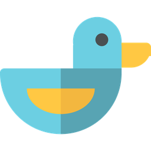

<p align="center"></p>

<h1 align="center">Duck</h1>

<p align="center"><b>Terminal com GPU e multiplexador embutido, feito para trabalhar com agentes de IA.</b><br>
Rust · wgpu · config em Lua · Windows primeiro, builds para Linux e macOS</p>

<p align="center"><a href="README.md">Read in English</a></p>

---

O Duck é emulador de terminal e multiplexador num programa só. Fechar a janela
desanexa em vez de matar os shells, e o terminal sabe quais panes rodam um
agente de IA (Claude Code, Codex, Kiro, Gemini, aider…) e o que cada um está
fazendo.

## Por que o Duck

- **Sessões que sobrevivem.** Cada shell vive num processo próprio
  (`ptyhost`). Fechar a janela, ou até uma queda do server, não derruba nada;
  o próximo server reconecta. Um checkpoint a cada 5 minutos restaura
  workspaces, abas e divisões depois de reiniciar a máquina, e **retoma as
  conversas do Claude Code** que estavam abertas (`claude --resume`).
- **Sabe dos agentes.** Cada aba mostra se o agente está trabalhando, pedindo
  aprovação ou se terminou. Aprove ou negue pelo aviso no canto da tela, sem
  trocar de aba. Painel lateral com o plano do agente, tokens de contexto e
  custo; linha do tempo da sessão; recados entregues quando o agente para;
  "corrigir com agente" manda o comando que falhou e a saída.
- **Orquestra agentes.** Loop até passar (o Duck roda os testes quando o
  agente para e devolve a falha para ele, até passar); mapa dos agentes, dos
  panes que eles abriram e dos subagentes; caixa de entrada com o que espera
  você; agente em worktree nova com porta própria; Rotinas que mandam pedidos
  ao Claude Code em horários marcados.
- **Blocos de comando.** Com a shell integration (OSC 133), cada comando vira
  um cartão com exit code e duração, botões de copiar, re-executar, recolher e
  fixar, e um minimapa que marca as falhas.
- **Fácil de achar.** Menus por assunto (`Ctrl+Shift+1..4`: orquestração,
  extensões, janela, configuração) e uma barra com os atalhos principais;
  tudo personalizável.
- **Cara própria.** Barra de título própria, abas em pílula (ou na lateral),
  panes como cartões arredondados, cursor suave, paleta que também busca abas,
  sessões, histórico e arquivos, 22 temas embutidos mais um gerado do papel de
  parede, Mica/Acrylic no Windows 11 e shaders de pós-processamento.
- **Programável.** Config em Lua com recarga automática, tabelas de atalhos,
  workflows, layouts, plugins WASM, CLI e servidor MCP para agentes
  controlarem o terminal (`duck cli spawn`, `read`, `send`, `blocks`,
  `last-failure`…).
- **Leve.** Um binário nativo (~19 MB), CPU parada perto de 0%, cerca de 12 mil
  linhas/s de vazão de saída.

## Instalação

Precisa do [Rust](https://rustup.rs) (stable). O primeiro build leva uns 5
minutos. O **[playbook](docs/PLAYBOOK.pt-BR.md)** tem o passo a passo
completo: pré-requisitos, conferência, cada extensão e as rotinas.

### Windows 10/11

```powershell
winget install Rustlang.Rustup
winget install Microsoft.VisualStudio.2022.BuildTools --override "--quiet --wait --add Microsoft.VisualStudio.Workload.VCTools --includeRecommended"
winget install OpenJS.NodeJS.LTS      # para as extensões
git clone https://github.com/herlondf/duck.git
cd duck
pwsh -File .\install.ps1 -All         # tudo: compila, PATH, ~/.duck.lua, menu Iniciar, abre no logon,
                                      # hooks e statusline do Claude Code, extensões compiladas
pwsh -File .\install.ps1              # só o terminal (as opções avulsas: -Boot, -ClaudeHooks, -Extensions)
```

### Linux

```bash
curl https://sh.rustup.rs -sSf | sh
sudo apt install build-essential pkg-config libxkbcommon-dev libwayland-dev libx11-dev   # Debian/Ubuntu
git clone https://github.com/herlondf/duck.git && cd duck
./install.sh                 # compila, ~/.local/bin, ~/.duck.lua, atalho no menu de apps
./install.sh --all           # + abre no login, hooks do Claude Code, extensões
```

### macOS

```bash
curl https://sh.rustup.rs -sSf | sh
git clone https://github.com/herlondf/duck.git && cd duck
./install.sh                 # compila, ~/.local/bin, ~/Applications/Duck.app
```

Depois rode `duck` (abre a janela) ou `duck doctor`, que confere config,
server, hooks, shell integration e as extensões ligadas (compiladas? falta
token?). Cada problema vem com o comando que resolve.

**Estado por sistema:** o Windows é o de uso diário. No Linux o projeto
compila e passa nos testes, mas foi pouco usado na prática. O macOS ainda não
foi testado. A tecla global do quick terminal e o Mica/Acrylic são só do
Windows.

## Primeiros passos

| Atalho | Ação |
|---|---|
| `Ctrl+Shift+P` | Paleta (comandos, abas, sessões, histórico, arquivos) |
| `Ctrl+Shift+1` / `2` / `3` / `4` | Menus: orquestração / extensões / janela / configuração |
| `Ctrl+Shift+/` | Todos os atalhos |
| `Ctrl+Shift+J` | Caixa de entrada (o sino ao lado do minimizar) |
| `Ctrl+Shift+U` | Mapa dos agentes |
| `Ctrl+Shift+Home` | Início: projetos recentes, sessões do Claude, ações |
| `Alt+\` / `Alt+-` | Dividir à direita / abaixo |
| `Ctrl+Shift+T` / `Ctrl+Shift+W` | Nova aba / fechar aba |
| `Ctrl+Shift+S` / `Ctrl+Alt+N` | Trocar / criar workspace |
| `Ctrl+Alt+M` | Mover a aba para outro workspace |
| `Ctrl+Shift+A` | Agent Manager: todos os agentes numa grade ao vivo |
| `Ctrl+Shift+I` / `Ctrl+Shift+Y` | Painel do agente / linha do tempo da sessão |
| `Ctrl+Shift+E` | Corrigir com agente o último comando que falhou |
| `Ctrl+Shift+Enter` | Editor de comando em várias linhas (desfazer, seleção) |
| `Ctrl+,` | Configurações: temas, sliders, shaders, fontes |

Embaixo ficam um badge por extensão (Sistema, Agentes, Azure…; clique abre o
painel) e a barra com os atalhos principais. Tudo se configura em
`~/.duck.lua`; veja o [duck.example.lua](duck.example.lua), que traz exemplos
comentados de todas as extensões.

## Extensões

Extensões são programas à parte (SDK oficial em TypeScript) que mandam dados
para o Duck, e o Duck desenha tudo: painel lateral, detalhe flutuante, item na
barra, comandos na paleta e avisos. Uma extensão que cai não derruba o
terminal, e uma extensão desligada não gasta memória.

### As que vêm junto

| Área | Extensões |
|---|---|
| Código | **GitHub** (notificações, revisões pedidas, PRs, issues; todas as contas do `gh auth login`), **Azure DevOps** (PRs, builds e o que está publicado em cada ambiente: releases clássicas por ambiente ou pipelines por branch, configuráveis por projeto), **Git** (branch, mudanças, worktrees e stashes do pane ativo) |
| Tarefas e erros | **Jira** (Server/DC e Cloud), **Rollbar** (erros ativos, resolver, silenciar), **Grafana** (consultas LogQL no Loki, aviso quando a contagem sobe) |
| Infraestrutura | **Containers** (Docker e Podman, também dentro do WSL), **Banco de dados** (consultas salvas em Postgres e Redis, só leitura por padrão), **Portas** (portas TCP abertas e o processo de cada uma) |
| Dia a dia | **Agenda** (Google/Outlook por URL iCal, lembretes e botão Entrar), **Notas** (por projeto e geral), **Snippets** (trechos de comando e histórico do que foi copiado), **Uso do Claude** (limites de 5h/7d e custo por perfil do Claude Code) |
| Agentes | **Rotinas** (pedidos ao Claude Code em horários marcados, com cron ou a cada N minutos, usando o login do plano; o resultado vira aviso e fica no histórico) |
| Outras | **Google Play** (releases e avaliações, com resposta), **Home Assistant** (luzes, interruptores, cortinas, avisos) |

Compile com `install.ps1 -Extensions` (ou `-All`). Elas começam desligadas;
ligue em `Ctrl+Shift+2` → "Extensões", onde também ficam as configurações e as
contas de cada uma. O [playbook](docs/PLAYBOOK.pt-BR.md#4-receitas-por-extensão)
tem uma receita para cada: onde gerar o token, o que pôr na config e como
conferir. As [Rotinas](docs/PLAYBOOK.pt-BR.md#5-rotinas) também estão lá, com
a resposta falada numa Echo ou no celular pelo Home Assistant.

### Contas e segredos

Token nunca vai para arquivo de config. O menu de Extensões pede o token, ou
você grava na mão:

```sh
echo <token> | duck secret set rollbar/<conta>
duck secret has rollbar/<conta>
```

No Windows ficam no Gerenciador de Credenciais (`duck:<nome>`, por usuário); no
Linux/macOS em `~/.duck/secrets`, com permissão 600. A do GitHub não precisa de
segredo: ela lê as contas do `gh`.

### Criar a sua

Ponha uma pasta com o manifesto `duck-extension.json` em
`~/.duck/extensions/<nome>` (pessoal) ou em `<duck>/extensions/<nome>`
(compartilhada por todos os usuários da máquina; a pessoal com o mesmo nome
ganha). Qualquer linguagem serve: o Duck roda o `command` do manifesto e
conversa por linhas JSON no stdin/stdout. O manifesto pode declarar
configurações, contas e segredos, e o menu de Extensões monta os formulários a
partir dele. Veja o [docs/EXTENSIONS.md](docs/EXTENSIONS.md) (em inglês); a
extensão do GitHub é a implementação de referência.

## Comparativo

Um retrato do que cada ferramenta faz de fábrica (plugins e scripts externos
podem acrescentar mais). ✅ sim · 🟡 em parte · ❌ não

| | Duck | WezTerm | Windows Terminal | Ghostty | kitty | Alacritty | Warp | Wave | tmux | Zellij |
|---|---|---|---|---|---|---|---|---|---|---|
| Windows (nativo) | ✅ | ✅ | ✅ | ❌ | ❌ | ✅ | ✅ | ✅ | ❌ | ❌ |
| Linux / macOS | 🟡 | ✅ | ❌ | ✅ | ✅ | ✅ | ✅ | ✅ | ✅ | ✅ |
| Renderização na GPU | ✅ | ✅ | ✅ | ✅ | ✅ | ✅ | ✅ | ✅ | ❌ | ❌ |
| Abas e divisões | ✅ | ✅ | ✅ | ✅ | ✅ | ❌ | ✅ | ✅ | ✅ | ✅ |
| Shells sobrevivem a fechar a janela | ✅ | 🟡 | ❌ | ❌ | ❌ | ❌ | ❌ | ✅ | ✅ | ✅ |
| Restaura o layout depois de reiniciar | ✅ | ❌ | 🟡 | ❌ | 🟡 | ❌ | 🟡 | 🟡 | 🟡 | ✅ |
| Retoma sessões de agente de IA depois de reiniciar | ✅ | ❌ | ❌ | ❌ | ❌ | ❌ | ❌ | ❌ | ❌ | ❌ |
| Estado do agente por aba (trabalhando / pede aprovação / terminou) | ✅ | ❌ | ❌ | ❌ | ❌ | ❌ | 🟡 | ❌ | ❌ | ❌ |
| Aprovar pedidos do agente de outra aba | ✅ | ❌ | ❌ | ❌ | ❌ | ❌ | ❌ | ❌ | ❌ | ❌ |
| Blocos de comando (exit code, duração) | ✅ | 🟡 | 🟡 | ❌ | 🟡 | ❌ | ✅ | ✅ | ❌ | ❌ |
| Config programável | Lua | Lua | JSON | texto | texto/Python | TOML | ❌ | JSON | texto | KDL |
| Plugins | Lua, WASM, extensões (qualquer linguagem) | Lua | ❌ | ❌ | Python | ❌ | ❌ | widgets | shell | WASM |
| API/CLI para agentes controlarem panes | ✅ (CLI + MCP) | ✅ (CLI) | 🟡 | ❌ | ✅ | ❌ | ❌ | 🟡 | ✅ | ✅ |
| Chat de IA embutido | ❌ | ❌ | ❌ | ❌ | ❌ | ❌ | ✅ | ✅ | ❌ | ❌ |
| Código aberto | ✅ | ✅ | ✅ | ✅ | ✅ | ✅ | ❌ | ✅ | ✅ | ✅ |

O Duck não tenta ser um app de chat de IA: é um terminal em que os agentes que
você já usa (na linha de comando) ficam visíveis e controláveis. Para um chat
integrado, o Warp e o Wave fazem isso; para só um terminal rápido no
Linux/macOS, o Ghostty, o kitty e o Alacritty estão mais maduros lá.

## Documentação

- [Playbook de instalação e configuração](docs/PLAYBOOK.pt-BR.md): passo a
  passo da instalação, de cada extensão e das rotinas, e problemas comuns.
- [Manual completo](docs/MANUAL.pt-BR.md): todos os atalhos, a CLI, os
  recursos de agente, segurança, persistência e a arquitetura.
- [Criar extensões](docs/EXTENSIONS.md) (em inglês).
- [Lista de funcionalidades e status](docs/FUNCIONALIDADES.md) e as
  [notas de pesquisa](docs/PESQUISA.md) que guiaram o projeto.

## Créditos

- Emulação de terminal: [alacritty_terminal](https://github.com/alacritty/alacritty).
  Renderização: [wgpu](https://wgpu.rs) e [glyphon](https://github.com/grovesNL/glyphon).
- Fonte embutida: JetBrains Mono (SIL Open Font License 1.1) com os ícones do
  [Nerd Fonts](https://www.nerdfonts.com).
- Ícone do pato: baseado num SVG em CC0 (domínio público) do [SVG Repo](https://www.svgrepo.com).
- Inspirado em WezTerm, herdr, Warp, Ghostty, kitty, Zellij, Wave e Kiro.

## Licença

MIT. Veja [LICENSE](LICENSE). A fonte embutida mantém a licença dela ([fonts/OFL.txt](fonts/OFL.txt)).
